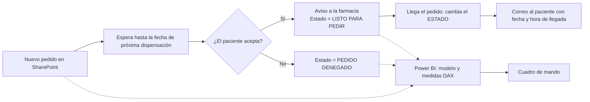

# Cuadro de mando de medicamentos refrigerados de alto valor en Power BI

**Power BI + SharePoint + Power Automate**

Cuadro de mando para controlar los medicamentos refrigerados de alto valor de una farmacia: agonistas GLP-1, insulinas y otros tratamientos en cadena de frío. Muestra cuánto dinero hay inmovilizado en la nevera, qué tratamientos se van a dispensar y a qué pacientes hay que avisar. Dos flujos de Power Automate preguntan al paciente si quiere su siguiente dispensación y le avisan cuando llega el pedido. Las capturas de este repositorio usan datos sintéticos.


## El problema

Es un proyecto demo que parte de lo que viví en cinco años trabajando en farmacia. Los agonistas GLP-1 (Ozempic, Mounjaro, Wegovy…) reúnen cuatro problemas a la vez:

- **Precio alto por unidad**: cada pluma parada en la nevera es mucho dinero inmovilizado.
- **Desabastecimiento**: hay que pedir con antelación y reservar la caja al paciente.
- **Demanda creciente**: cada mes hay más pacientes en tratamiento.
- **Pacientes que no recogen**: se pide para un paciente que luego no viene.

El último es el más caro, porque **un refrigerado solo se puede devolver al mayorista en las 48 horas siguientes a recibirlo** (10 días en el resto de productos). Pasado ese plazo, la caja se queda en la nevera hasta que otro paciente la necesite, o hasta que caduca.

El programa de gestión de la farmacia no da una vista del stock refrigerado ni avisa al paciente. La idea del proyecto es **pedir solo lo que el paciente ha confirmado que va a recoger, y en el momento adecuado**.

## La solución

1. Cada pedido de un paciente se registra en una lista de **SharePoint**, con la fecha de la próxima dispensación.
2. Cuando llega esa fecha, **Power Automate** pregunta al paciente por correo si quiere el tratamiento. Si acepta, avisa a la farmacia y marca el pedido como `LISTO PARA PEDIR`. Si no acepta, lo marca como `PEDIDO DENEGADO` y no se inmoviliza dinero en la nevera.
3. Cuando cambia el estado del pedido (por ejemplo, porque ha llegado), un segundo flujo envía al paciente un correo con la fecha y hora de llegada.
4. **Power BI** lee las listas y calcula con **DAX** el stock en nevera, el dinero inmovilizado, el avance de cada tratamiento y la prioridad de cada pedido.



### Lista de SharePoint


La lista `STOCK_CONTROL` es la única entrada de datos: la farmacia registra cada pedido y los flujos actualizan su estado.

| Columna | Uso |
| --- | --- |
| `Título` | Producto y dosis (p. ej. *SAXENDA 6 MG*). |
| `CODIGO NACIONAL` | Clave para relacionar con el catálogo de productos. |
| `TIPO DE PRODUCTO` | Agonistas GLP-1, insulinas, antidiabéticos orales u otros. |
| `ESTADO DEL PEDIDO` | `LISTO PARA PEDIR`, `PEDIDO DENEGADO`… Lo actualizan los flujos. |
| `FECHA PROXIMA DISPENSACION` | Cuándo se pregunta al paciente. El flujo 1 espera hasta esta fecha. |
| `FECHA REGISTRO` | Inicio del tratamiento. Base de `%progreso`. |
| `EMAIL` / `TELEFONO` | Contacto del paciente. En el informe solo se ve el correo enmascarado. |
| `FECHA Y HORA` | Fecha y hora de llegada que se comunican al paciente. |
| `IMPORTE` | Valor del pedido. Base del dinero en nevera e inmovilizado. |
| `FARMACIA` | Farmacia que registra el pedido. Permite que varias farmacias de un grupo compartan la solución y filtren por farmacia. |
| `ORIGEN` | `Stock` (servido en el momento) o `Pedido` (hubo que pedirlo). Base de la tasa de servicio inmediato. |
| `COMENTARIO` | Notas libres. |

En la captura, la columna de correo está pixelada.

### Flujo 1: confirmación del pedido


| Paso | Acción | Qué hace |
| --- | --- | --- |
| 1 | **Cuando se crea un elemento** (SharePoint) | Se dispara con cada pedido nuevo en la lista de pedidos. |
| 2 | **Redactar** | Prepara los datos del pedido para el correo. |
| 3 | **Retraso hasta** | Espera hasta la fecha de próxima dispensación. |
| 4 | **Enviar correo electrónico con opciones** (Outlook) | Pregunta al paciente: *Acepto / No acepto*. |
| 5 | **Condición**: acepta | Envía un aviso a la farmacia y actualiza el elemento con `Estado = LISTO PARA PEDIR`. |
| 5 | **Condición**: no acepta | Actualiza el elemento con `Estado = PEDIDO DENEGADO`. |

### Flujo 2: aviso de llegada


| Paso | Acción | Qué hace |
| --- | --- | --- |
| 1 | **Cuando se crea o modifica un elemento o un archivo** (SharePoint) | Se dispara con cualquier cambio en la lista de pedidos. |
| 2 | **Obtener cambios para un elemento o archivo (solo propiedades)** | Compara el elemento con su versión anterior. |
| 3 | **Redactar** | Comprueba si ha cambiado la columna `ESTADO`. |
| 4 | **Condición** | Si ha cambiado `ESTADO`, envía al paciente un correo con la fecha y hora de llegada. Si no, no hace nada. |

Con **Obtener cambios**, el correo solo sale cuando cambia el estado y no con cualquier otra edición del pedido.

## Qué muestra el cuadro de mando

| Visual | Qué responde |
| --- | --- |
| Inmediatez en insulinas | ¿Qué parte de los pedidos de insulina se sirve desde stock, sin tener que pedirlos? |
| Servicio inmediato GLP-1 frente al objetivo mensual | ¿Cumplo el objetivo que me he puesto? (El 20 % es un valor de ejemplo, configurable por farmacia.) |
| Total de dinero en nevera | ¿Cuánto stock refrigerado tengo hoy? |
| Pedidos por grupo y por producto | ¿Qué pesa más: GLP-1, insulinas, antidiabéticos orales u otros? |
| Dinero inmovilizado (importe frente a días de stock) | ¿Qué producto lleva más tiempo parado y cuánto vale? Las líneas verticales marcan los plazos de devolución: **48 h** para refrigerados y **10 días** para el resto. Todo lo que queda a la derecha ya no se puede devolver. |
| Dispensación futura con semáforo | ¿Qué pedidos hay que hacer o confirmar esta semana, y cuáles son prioritarios? |
| Top 10 de tratamiento consumido, con demora | ¿Qué pacientes están a punto de terminar su tratamiento y suelen tardar en recoger? |
| Pedidos mensuales | ¿Cómo evoluciona la demanda? |

## Stack

- **SharePoint**: listas como origen de datos.
- **Power BI**: Power Query, modelo en estrella y DAX. Publicado en el Power BI Service con actualización programada.
- **Power Automate**: correos con opciones, esperas programadas y actualización de estados.
- **Power Apps**: primer prototipo del formulario de registro de pedidos (ver [Qué haría distinto](#qué-haría-distinto)).
- **Outlook**: envío de los correos a pacientes y a la farmacia.

## Modelo de datos y medidas clave


Esquema en estrella con una tabla de hechos, dos dimensiones y una tabla aparte para las medidas:

| Tabla | Tipo | Contenido |
| --- | --- | --- |
| **`STOCK_CONTROL`** | Hechos | Un registro por pedido de paciente: `CODIGO NACIONAL`, `EMAIL`, `FARMACIA`, `ESTADO DEL PEDIDO`, `ORIGEN`, `FECHA REGISTRO`, `FECHA DISPENSACION FUTURA` y `COMENTARIO`. Tiene columnas calculadas como `emailmasked` (correo enmascarado para mostrarlo en el informe), `EnlaNevera` y `Chivatorecogida`. |
| **`PRODUCTS`** | Dimensión | Catálogo por `CODIGO NACIONAL`, con `TIPO DE PRODUCTO` (Agonistas GLP-1, insulinas, antidiabéticos orales y otros) y la columna calculada `Criterio_Stock`. |
| **`TIME_TABLE`** | Dimensión de fechas | Calendario (`Date`). |
| **`Medidas`** | Tabla de medidas | Agrupa las medidas DAX: `%progreso`, `Dias en STOCK (Real)`, `Etiqueta%ypereza`, `Filtroproximos7dias`, etc. |

Relaciones:

- `PRODUCTS` 1 → * `STOCK_CONTROL` por `CODIGO NACIONAL`.
- `TIME_TABLE` 1 → * `STOCK_CONTROL` con tres relaciones de fecha: la activa es `FECHA REGISTRO`, que se usa en los pedidos mensuales. Las inactivas son la fecha de dispensación futura y la de llegada, y se activan con `USERELATIONSHIP` en las medidas que las necesitan. Así hay una sola tabla calendario para analizar las tres fechas.

Transformaciones en Power Query:

- Conversión de tipos: fechas, importes y códigos nacionales que SharePoint devuelve como texto.
- Eliminación de las columnas internas de SharePoint (Id, GUID, autor, versiones…) para aligerar el modelo.
- Construcción de `PRODUCTS` a partir de la lista: códigos nacionales únicos con su tipo de producto.

### `Tasa Servicio Inmediato`: qué parte de los pedidos se sirve en el momento

Un pedido es inmediato cuando se sirve desde el stock de la farmacia, sin tener que pedirlo. El `+ 0` hace que la tarjeta muestre 0 % en vez de quedarse en blanco cuando no hay pedidos.

```dax
Tasa Servicio Inmediato =
VAR Total = COUNTROWS ( STOCK_CONTROL )
VAR Inmediatos =
    CALCULATE ( COUNTROWS ( STOCK_CONTROL ), STOCK_CONTROL[ORIGEN] = "Stock" )
RETURN
    DIVIDE ( Inmediatos, Total ) + 0
```

### `%progreso`: cuánto tratamiento ha consumido el paciente

Calcula qué parte del tiempo entre el registro del pedido y la próxima dispensación ya ha pasado. Alimenta el visual *Top 10 TTO consumido*: un paciente al 97 % está a punto de necesitar su siguiente caja.

Se da un **margen de tolerancia del 20 %**: un paciente puede ir algo tarde con su tratamiento. Por encima del 120 % se considera que ya no lo sigue y sale del ranking.

```dax
%progreso =
VAR fechainicio   = SELECTEDVALUE ( STOCK_CONTROL[FECHA REGISTRO] )
VAR FECHAFINAL    = SELECTEDVALUE ( STOCK_CONTROL[FECHA DISPENSACION FUTURA] )
VAR FECHAHOY      = TODAY ()

VAR DURACIONTOTAL = DATEDIFF ( fechainicio, FECHAFINAL, DAY )
VAR DIASPASADOS   = DATEDIFF ( fechainicio, FECHAHOY, DAY )
VAR RESULTADO     = DIVIDE ( DIASPASADOS, DURACIONTOTAL )

RETURN
    SWITCH (
        TRUE (),
        FECHAHOY > FECHAFINAL, BLANK (),
        ISBLANK ( fechainicio ) || ISBLANK ( FECHAFINAL ), BLANK (),
        fechainicio = FECHAFINAL, 1,
        RESULTADO <= 0, BLANK (),
        RESULTADO > 1.2, BLANK (),
        RESULTADO
    )
```

### `Etiqueta%ypereza`: etiqueta del Top 10

Junta el avance del tratamiento y la demora habitual del paciente en una sola etiqueta de datos, por ejemplo `97% (+1d demora)`.

```dax
Etiqueta%ypereza =
VAR Porcentaje = [%progreso]
VAR Pereza     = [TASAPEREZA]
RETURN
    FORMAT ( Porcentaje, "0%" ) & " (+"
        & IF ( ISBLANK ( Pereza ), "0", FORMAT ( Pereza, "0" ) )
        & "d demora)"
```

### `Semáforo Acción Pedido`: prioridad de cada pedido

Combina lo caro que es el producto con lo fiable que es el paciente. `[TASAPEREZA]` mide los días que el paciente suele tardar en recoger. Si son 3 o menos, se le considera cliente fiel.

El umbral de 3 días está ligado al plazo de devolución de 48 h. Un paciente que suele tardar más deja la caja fuera de plazo antes de que se sepa si va a venir. Si al final no viene, la farmacia ya no la puede devolver.

| Valor | Icono | Caso |
| --- | --- | --- |
| 3 | 🔴 | GLP-1 y paciente que suele tardar: confirmar antes de pedir, porque si no viene la caja no se puede devolver. |
| 2 | 🟡 | GLP-1 y paciente fiel: pedir, con seguimiento. |
| 1 | 🟢 | No es GLP-1: riesgo bajo. |

```dax
Semáforo Acción Pedido =
VAR EsCritico =
    IF ( SELECTEDVALUE ( PRODUCTS[TIPO DE PRODUCTO] ) IN { "Agonistas GLP-1" }, TRUE (), FALSE () )

VAR DiasPereza    = [TASAPEREZA]
VAR EsClienteFiel = IF ( DiasPereza <= 3, TRUE (), FALSE () )

RETURN
    SWITCH (
        TRUE (),
        EsCritico = TRUE () && EsClienteFiel = FALSE (), 3,   -- 🔴 caso 1
        EsCritico = TRUE () && EsClienteFiel = TRUE (),  2,   -- 🟡 caso 2
        EsCritico = FALSE (), 1                               -- 🟢 caso 3
    )
```

En el visual, el valor se muestra como icono con formato condicional.

## Datos y privacidad (RGPD)

- Es un proyecto demo: este repositorio **no contiene datos reales** ni el archivo `.pbix`, solo capturas hechas con un conjunto de datos sintético.
- **Minimización de datos**: el informe nunca muestra el correo completo del paciente. La columna calculada `emailmasked` deja solo las primeras letras (`luc*****@gmail.com`), lo justo para identificarlo. Esto permite además enseñar el informe en demos y capturas sin exponer datos.
- En la captura de SharePoint, la columna de correo está pixelada.

## Estructura del repositorio

```text
.
├── README.md
├── LICENSE
└── docs/
    ├── dashboard.png                          # cuadro de mando
    ├── sharepoint_lista.png                   # lista STOCK_CONTROL
    ├── modelo_datos.png                       # vista de modelo en Power BI
    ├── powerautomate_confirmacion_pedido.png  # flujo 1
    ├── powerautomate_aviso_llegada.png        # flujo 2
    ├── dax_tasa_servicio_inmediato.png        # capturas de las medidas DAX
    ├── dax_progreso.png
    ├── dax_etiqueta_progreso_pereza.png
    └── dax_semaforo.png
```

## Cómo recrearlo

1. Crea en SharePoint la lista de pedidos con las columnas de `STOCK_CONTROL` (`CODIGO NACIONAL`, `EMAIL`, `ESTADO DEL PEDIDO`, `ORIGEN`, `FECHA REGISTRO`, `FECHA DISPENSACION FUTURA`…) y una lista de productos con `CODIGO NACIONAL` y `TIPO DE PRODUCTO`.
2. Monta los dos flujos de Power Automate siguiendo las tablas de pasos de arriba.
3. En Power BI Desktop, conéctate a las listas con el conector **Lista de SharePoint Online**, añade una tabla calendario, crea las relaciones del modelo y las medidas DAX de este README.
4. Monta los visuales tomando como referencia la captura del cuadro de mando.

## Qué se ve con los datos de ejemplo

Las cifras son del conjunto de datos sintético. No miden el impacto en la farmacia real; enseñan qué preguntas responde el cuadro de mando de un vistazo:

- **48.270 €** en stock refrigerado hoy, con productos de más de 100 € que llevan más de 300 días parados, muy lejos del plazo de devolución.
- En insulinas, el **87,85 %** de los pedidos se sirve desde stock. En GLP-1 solo el **6,06 %**, por debajo del objetivo del 20 %: es el reflejo del desabastecimiento.
- **416 pedidos de GLP-1 frente a 107 de insulinas**: el grupo más caro es también el de más demanda.
- Lista diaria de pacientes que están a punto de terminar su tratamiento, con su demora habitual en recoger y un semáforo que dice qué pedidos confirmar antes de pedir.

## Decisiones y aprendizajes

### Decisiones de negocio

| Decisión | Por qué |
| --- | --- |
| Foco en GLP-1 | Es el grupo donde coinciden precio alto, desabastecimiento, demanda creciente y pacientes que no recogen. |
| Confirmar con el paciente **antes** de pedir | Un refrigerado solo se puede devolver en 48 h. Si el paciente no viene, el coste lo asume la farmacia. |
| Semáforo con umbral de 3 días | Separa a los pacientes que recogen dentro del plazo de devolución de los que dejan la caja fuera de plazo. |
| Correo y no WhatsApp | Coste cero: Outlook viene con Microsoft 365. Muchas farmacias no tienen móvil de empresa para escribir a los pacientes por WhatsApp. |
| Columna `FARMACIA` desde el inicio | Una misma solución sirve para varias farmacias de un grupo. |
| Objetivos configurables | El 20 % de servicio inmediato en GLP-1 es un valor de ejemplo. Cada farmacia pondría el suyo. |

### Decisiones técnicas

| Decisión | Por qué |
| --- | --- |
| Listas de SharePoint como origen | Vienen incluidas en Microsoft 365, sin servidor ni coste extra, y tienen desencadenadores nativos en Power Automate. |
| «Obtener cambios» en el flujo de aviso | Sin este paso, el correo saltaría con cualquier edición del pedido. Con él, solo cuando cambia el estado. |
| Modelo en estrella con tabla de medidas | Separa hechos, dimensiones y lógica. Las medidas quedan agrupadas y fáciles de mantener. |
| Una tabla calendario con relaciones inactivas | Una sola `TIME_TABLE` sirve para analizar registro, dispensación y llegada, activando cada relación con `USERELATIONSHIP`. |
| Enmascarar correos en el modelo | Aplica la minimización de datos del RGPD y permite hacer demos sin exponer datos. |
| Publicado con actualización programada | El cuadro de mando se actualiza solo, sin que nadie tenga que abrir Power BI Desktop. |

### Problemas encontrados

- **Zonas horarias**: SharePoint guarda las fechas en UTC y aparecían desplazadas al pasar a Power BI y al correo. Hay que fijar un criterio de zona horaria común en SharePoint, Power Automate y Power BI.
- **Límite de espera de Power Automate**: una ejecución no puede durar más de 30 días, así que «Retraso hasta» no sirve para fechas más lejanas. Aquí no afecta porque las dispensaciones son mensuales, pero lo tuve en cuenta como límite del diseño.

### Qué haría distinto

- **Separar las listas desde el inicio**: pacientes, productos y pedidos en listas distintas, en vez de una sola lista con todo. El `v2.1` del nombre de la lista viene de esas iteraciones.
- **Facilitar el registro**: los visuales responden a lo que necesita la farmacia. El punto débil es la entrada de datos. Primero probé a que el personal registrara cada pedido desde una app de **Power Apps**, pero en mitad de la jornada nadie tiene tiempo de rellenar un formulario. La adopción depende más de lo fácil que sea registrar un pedido que del cuadro de mando.

## Próximos pasos

- **Registro por foto del ticket**: una app que lea el ticket del pedido (OCR) y rellene la lista sola, para que registrar un pedido cueste segundos.
- **Previsión de demanda**: un modelo de machine learning que anticipe los pedidos de GLP-1 por mes y por paciente, para pedir con antelación en plena época de desabastecimiento.
- **WhatsApp como canal opcional**: solo si la farmacia lo pide y asume el coste del servicio.

## Autor

**Miguel Ángel Leo Acedo**, analista de datos / BI. Cinco años en farmacia.

- LinkedIn: https://www.linkedin.com/in/miguel-leo-acedo
- Otro proyecto: SmartPharma, https://smartpharmai.github.io/

## Licencia

[MIT](LICENSE).
